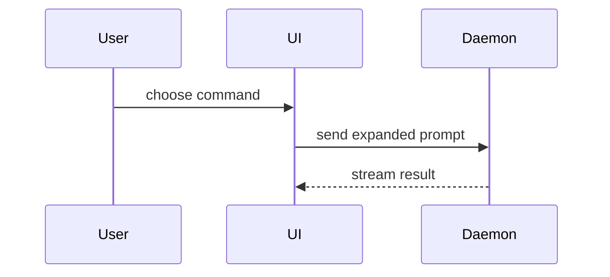

# PR

Write PR copy a human reviewer can scan in twenty seconds. Cluster by concern. The diff is the source of truth; commit messages are clustering hints.

## Range

Default base is the repo's default branch (`origin/HEAD`, else `main`). The user can name another. The range is `base...HEAD`. Uncommitted files are not in the PR: mention them, leave them out of the copy.

Done when the base and range are known.

## Map

Read the log and the diff for the range. Lockfiles and generated files are not narrative; if they are the only change they go under Chore.

Cluster by concern. Name each cluster from the work. Use the natural number of clusters. Deps, upgrades, and generated files go under Chore.

Done when every change in the range sits in exactly one named cluster.

## Write

Output the title and body in this shape:

```markdown
## Summary

<diagram, diff-sketch, or tree>

## Evidence

- **Before:** <screenshot/output/failing test run>
  **After:** <screenshot/output/passing test run>

## Merge Danger

**Door:** <one-way or two-way>

<optional: description>

**Blast Radius:** <one-word description>

<optional: potential ramifications of merge>
```

**PR Title:** one line, concrete. Name the clusters if several, or the one change if one. Title the PR after the clusters, not the template sections.

Skip all preambles and keep prose brief. Use the user's domain language from `GLOSSARY.md`.

### Summary

Pick the smallest view that makes the key point clear. Use the cluster map from above as the outline; each visual should name a real change in the diff.

- Show logic or an algorithm as pseudocode:

```text
on(save)
  if content is unchanged
    return cached result
  write new content
  return fresh result
```

- Show runtime control flow as a call tree:

```text
submitForm
  createSession
    persistPrompt
    launchAgent
  navigateToSession
```

- Show UI structure as a component tree, including state and module boundaries that matter:

```text
<SessionPage> (apps/example/src/routes/session.tsx)
  useSessionEvents()
  <SessionToolbar>
    <RunSkillButton> (packages/ui)
```

- Show file responsibility or a broad refactor as a shallow file tree:

```text
src/
├── commands/       # parses user actions
├── sessions/       # owns session state
└── transport/      # sends API requests
```

- Show component interaction, control flow, or data flow with Mermaid:



- Use `diff` when the point is what changes and the surrounding shape already exists. Match the diff shape to the topic.

For a component change:

```diff
 <SessionPage>
   useSessionEvents()
   <SessionToolbar>
+    <RunSkillButton />
   <SessionTimeline>
+    <SkillResultCard />
```

For a file-layout change:

```diff
 src/
 ├── commands/
+│   └── show-me.ts       # expands the slash command
 ├── sessions/
-└── transport.ts
+└── transport/
+    ├── client.ts
+    └── stream.ts
```

For a call-tree or call-stack change:

```diff
 submitForm
   createSession
     persistPrompt
+    expandSkillMention
     launchAgent
-  navigateToSession
+  navigateToSession
+    subscribeToEvents
```

For a state or control-flow change:

```diff
 on(save)
-  write content
+  if content is unchanged
+    return cached result
+  write new content
+  invalidate cache
```

- Show the whole block when most of it is new, when omitted context would hide ownership or order, or when the user needs a copyable target shape:

```ts
function expandSkill(command: string): string {
  const skillName = command.slice(1);
  return `use the ${skillName} skill`;
}
```

Place each visual next to the short text it supports. Keep only the calls, files, props, states, and boundaries needed to answer the user's current question. Use one or several; it is unlikely you need all of them.

### Evidence

Concrete evidence that the change works. Show a before and after.

Screenshots are S-tier when the environment is set up for it and the change is visual.

Execution-based evidence is A-tier: test results, console output. Show the exact test that now fails and passes, using pseudocode.

### Merge Danger

Describe whether it is a one-way or two-way door. You can walk back through two-way doors, but not one-way doors. A PR that is cheap to roll back is lower risk. Changes that involve destructive actions or hard-to-reverse decisions are one-way doors.

The blast radius is the potential impact or scope of the changes introduced by this PR. Consider all possibilities, such as layout shift, breakage for consumers, or mobile responsiveness.

Done when every cluster in the map is represented in the Summary, and the title names the clusters.

## Unslop

Call the Skill tool with "unslop" on the title and body. Done when the self-audit finds no remaining AI tells.

## Open

When the user asked to create or open the PR, run `gh pr create` with that title and body against the base. Done when the command prints the PR URL. When they only asked for copy, stop after Unslop.
